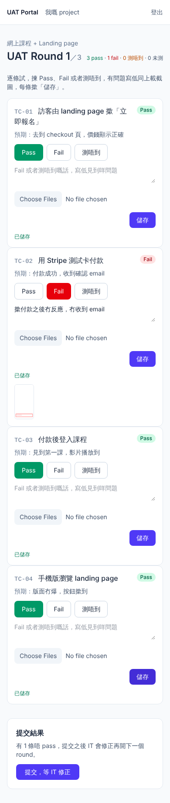
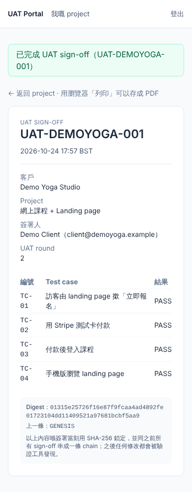
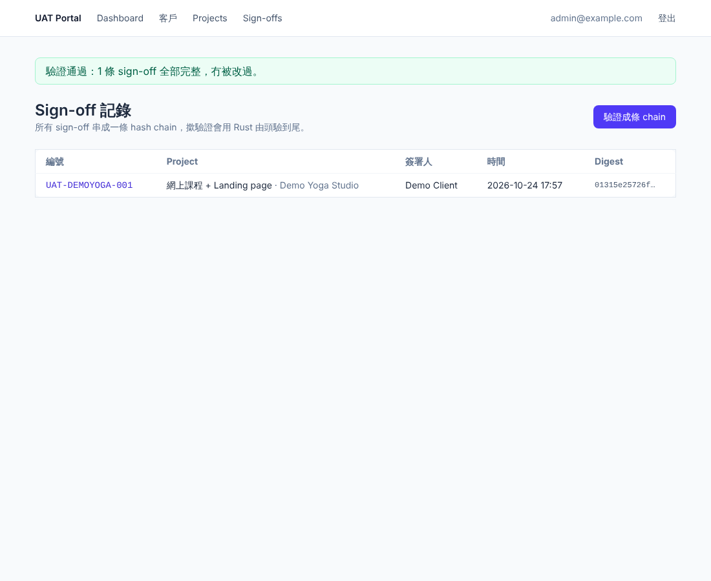
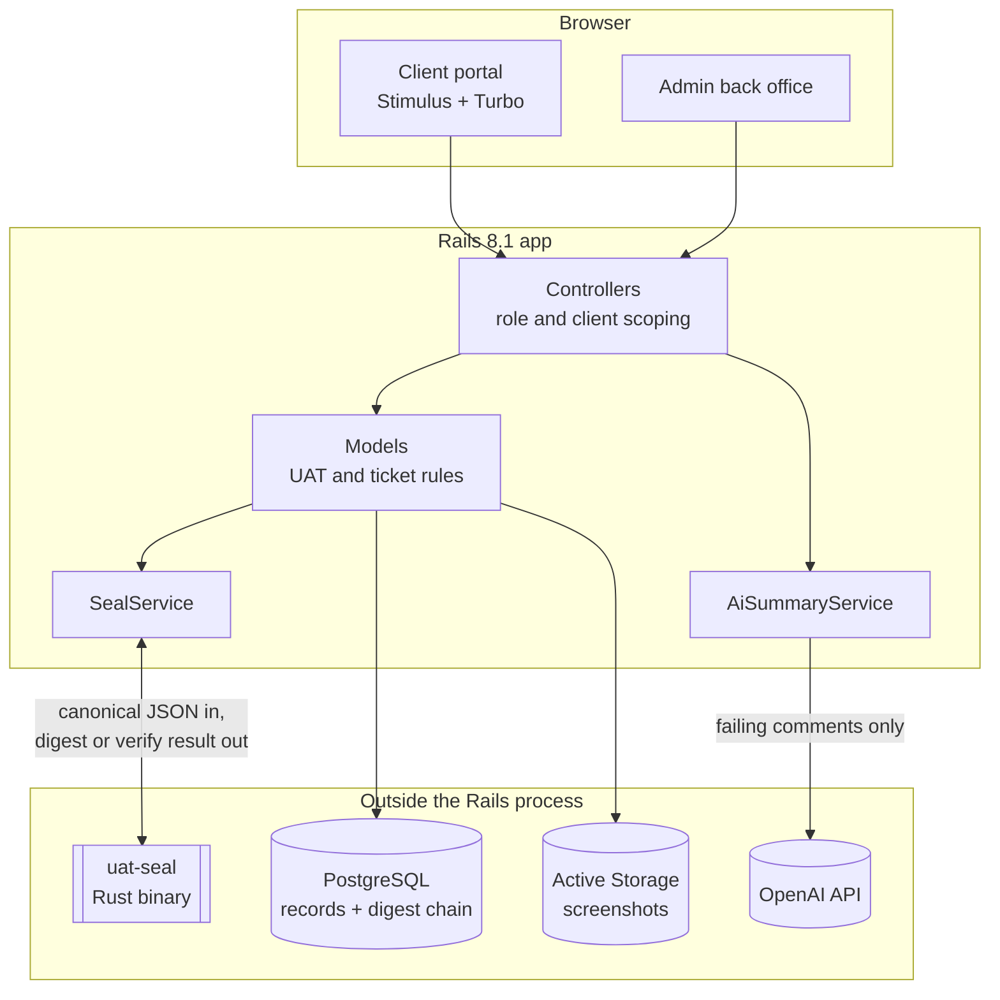
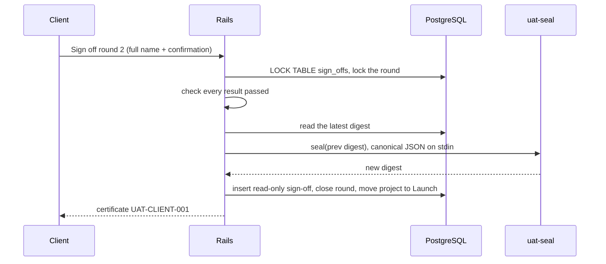

# UAT Portal

A client portal for the last mile of a software project: **user acceptance testing, sign-off and maintenance**, with every sign-off sealed into a tamper-evident hash chain by a small Rust tool.

Built with **Ruby on Rails 8.1**, **Rust** and **Hotwire (Stimulus / Turbo)**, plus an OpenAI-powered triage of client feedback.

**[Watch the 90-second demo](docs/demo.mp4)**: a failed round, a fix, a sealed sign-off, and a database edit caught by verification.

> 廣東話版本：[README.zh-HK.md](README.zh-HK.md)

| Client tests a round (mobile) | Sealed sign-off certificate | One-click chain verification |
| --- | --- | --- |
|  |  |  |

The interface is in Cantonese because it is built for my own clients in Hong Kong.

## The problem

As a freelance developer I deliver websites and automation to small businesses. The end of every project used to look the same: test cases in a Word document, feedback scattered across WhatsApp, a sign-off PDF emailed back, and no clear answer when a client later says "I never approved that" or asks for a fourth round of changes that the contract does not cover.

UAT Portal replaces that with one place where:

- the client works through each test case and marks it pass, fail or blocked, with comments and screenshots;
- the number of UAT rounds is enforced by the contract, and extra rounds need an approved change request;
- the final sign-off freezes exactly what was tested and who approved it, in a record that cannot be quietly edited afterwards;
- after launch, the client raises maintenance tickets and receives a monthly report of the time spent.

## Features

- **Delivery phases**: each project moves through Requirement, Design, Development, SAT, UAT, Launch and Maintenance, shown as a progress bar to both sides.
- **UAT rounds**: opening a round creates a result for every test case. Failed or blocked results need a comment. The submit panel updates live through Turbo Streams as the client works.
- **Round limits and change requests**: allowed rounds = rounds in the contract + rounds added by approved change requests (`CR-CLIENT-001`).
- **Sealed sign-off**: when every test passes, the client signs with their full name. The results are frozen as canonical JSON, sealed by Rust and chained to the previous sign-off. The record is read-only and numbered `UAT-CLIENT-001`.
- **Chain verification**: one button re-checks every sign-off from the first to the last and reports exactly which record broke and why.
- **Maintenance tickets**: available after launch, with priority, screenshots and time logs that the client can read.
- **Monthly maintenance report**: tickets opened and resolved, time spent per ticket and work done, printable to PDF.
- **AI triage**: failing UAT comments are summarised and classified as *bug*, *change request* or *unclear*, with a prompt to raise a change request when scope is creeping.

## Architecture



Rails owns everything except the integrity-critical step. The Rust binary does two things only: `seal` computes a digest and `verify` walks the whole chain.

## How the hash chain works

Each sign-off stores its frozen payload, its own digest and the digest of the sign-off before it:

```
digest(n) = SHA-256( digest(n-1) + "\n" + canonical_json(payload n) )
digest(0) uses the literal "GENESIS"
```



Payloads are canonicalised (keys sorted recursively) so the same content always produces the same digest. The table lock stops two sign-offs racing for the same previous digest.

`uat-seal verify` reads `digest<TAB>prev_digest<TAB>payload` lines in order and catches:

| Tampering | Detected as |
| --- | --- |
| Editing a stored payload (for example changing a result or the signer) | `digest_mismatch` at that record |
| Deleting a sign-off | `prev_mismatch` at the next record |
| Re-ordering sign-offs | `prev_mismatch` |
| Editing a payload and recomputing its digest to hide it | `prev_mismatch` at the next record |
| Malformed rows | `format_error` |

### Why Rust for this part

The seal is the one piece whose correctness the whole sign-off depends on, so I kept it small, pure and separately testable: about 230 lines with 10 unit tests, no I/O beyond stdin and stdout, and no dependency on the Rails runtime. Shipping it as a standalone binary also means the chain can be verified from an export without running the app. The Rails side calls it through `Open3`; moving to a native extension (magnus / rb-sys) would be a drop-in change behind `SealService`.

## Security decisions

- **Access control**: admin routes require the admin role; every client query is scoped to the client's own company, and other clients' records return 404 rather than 403.
- **Only the client can sign**: the admin cannot sign on a client's behalf. Signed rounds and their results cannot be edited.
- **No demo accounts in production**: production seeds create nothing unless `ADMIN_EMAIL` and `ADMIN_PASSWORD` are set. This was caught while testing a production boot, where the first version would have created a demo admin with a known password.
- **Untrusted model output**: AI results are only accepted for test case codes that exist and categories on an allow-list; anything else is dropped. Client comments are sent as data, and the prompt tells the model not to follow instructions inside them.
- **Uploads**: screenshots must be images and at most 10 MB each.
- **Scanning**: Brakeman reports 0 warnings, bundler-audit and importmap audit report no known vulnerabilities, and all three run in CI.

## Tests

```bash
bin/rails test           # 62 tests: models, services, full UAT and maintenance journeys
cd seal && cargo test    # 10 tests: sealing and every tampering case above
```

The integration tests walk the real flows end to end: a client fails a test with a screenshot, the round is resubmitted, the client signs off, the admin verifies the chain, and a direct database edit is then reported as broken. The Rails tests call the real Rust binary.

CI (GitHub Actions) runs `cargo fmt`, `cargo clippy -D warnings`, `cargo test`, RuboCop, Brakeman, the dependency audits and the Rails suite against PostgreSQL.

## Running locally

```bash
brew install postgresql@16 && brew services start postgresql@16
# Ruby 3.3+ and Rust (rustup) required
bundle install
bin/build-seal          # builds the Rust binary into bin/uat-seal (rerun on a new machine)
bin/rails db:setup      # creates the database and demo data (sign-in details are in db/seeds.rb)
bin/dev                 # http://localhost:3000
```

Optional AI triage:

```bash
export OPENAI_API_KEY=sk-...
export OPENAI_MODEL=gpt-4o-mini   # any chat model that supports JSON output
```

## Deployment

The `Dockerfile` builds and tests `uat-seal` in a Rust stage, then copies the binary into the Rails image. `render.yaml` is a Render Blueprint with PostgreSQL and a persistent disk for screenshots. Set `RAILS_MASTER_KEY`, `ADMIN_EMAIL`, `ADMIN_PASSWORD` and optionally `OPENAI_API_KEY`; migrations run automatically on boot.

## Limitations and next steps

- **The chain proves integrity, not identity.** Someone with full database access could rebuild the entire chain from scratch. The next step is to anchor the latest digest outside the system: email it to the client at each sign-off, or use an RFC 3161 timestamping service.
- **Not a legal e-signature.** Contract terms (for example "no reply within 5 working days counts as acceptance") still belong in the signed contract.
- **Interface language**: Cantonese only for now; adding English through Rails i18n is straightforward.
- **AI triage is advisory.** It suggests, the developer decides.

## How it was built

Built over four short iterations, using Claude (Anthropic) as an AI pair programmer for implementation, with each iteration checked by automated tests and a scripted browser walkthrough before moving on. Several bugs were caught that way, including the production demo-account issue above and a time total that counted an unsaved form entry.
